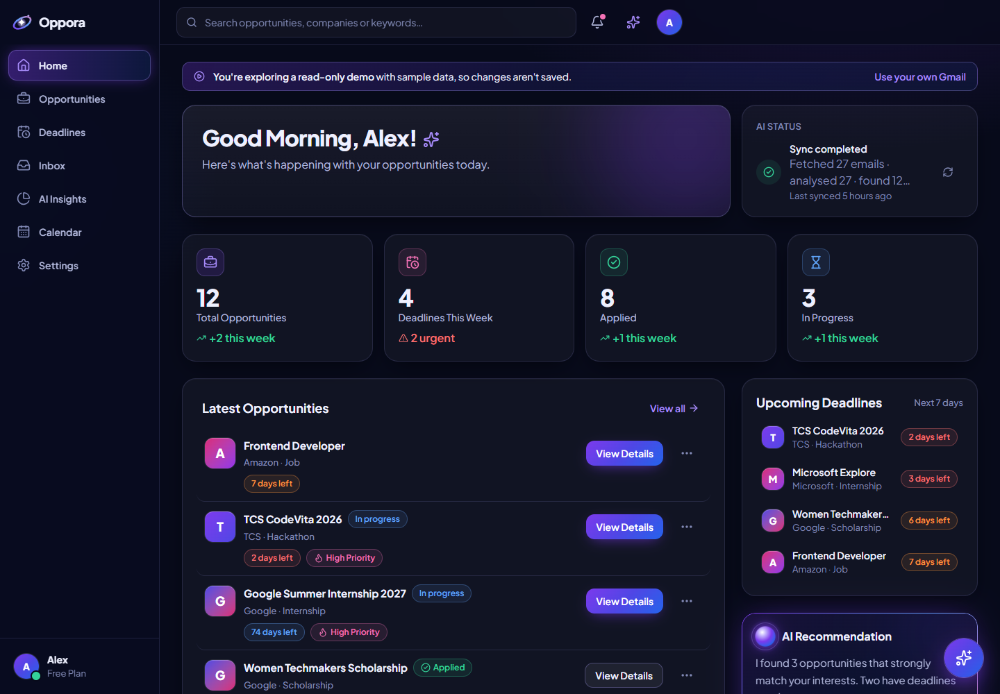
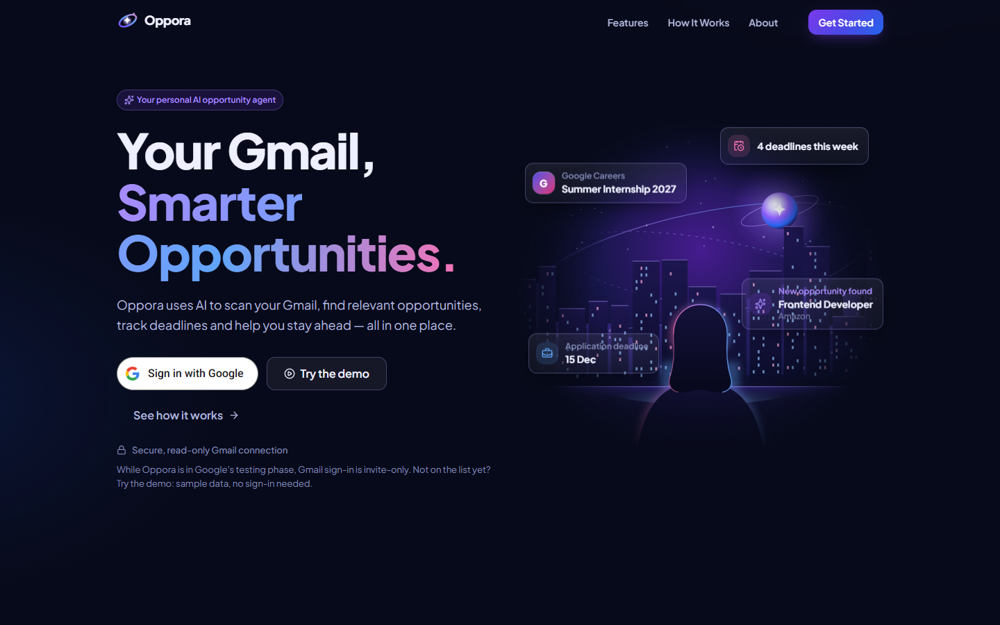
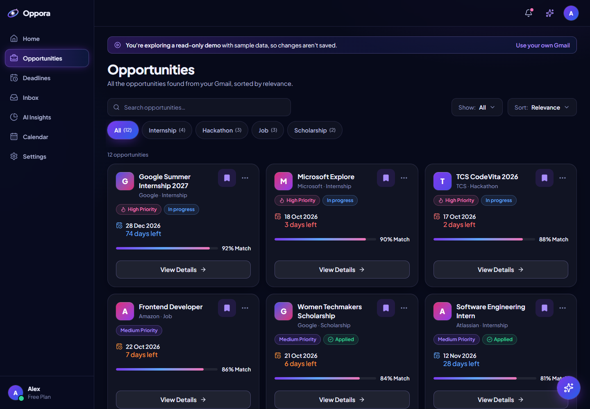
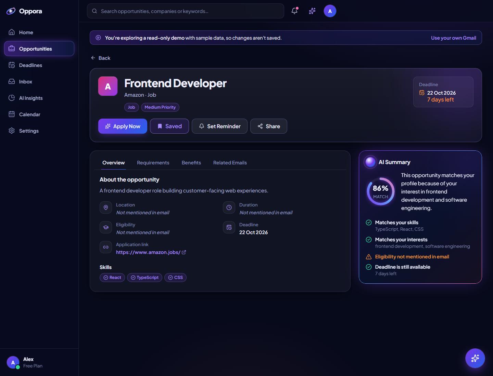
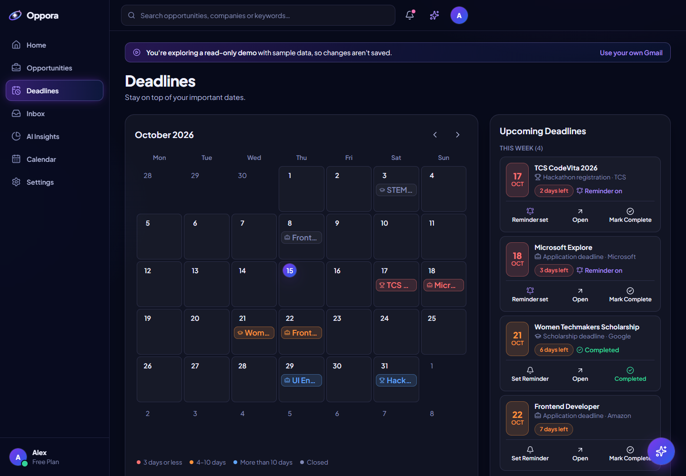
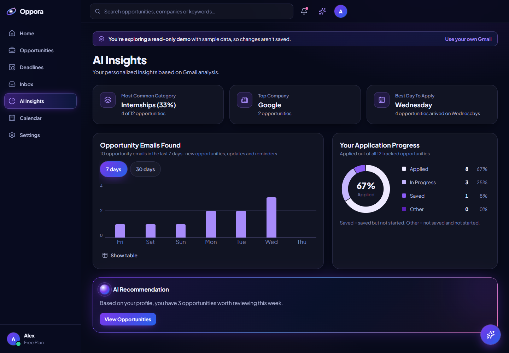
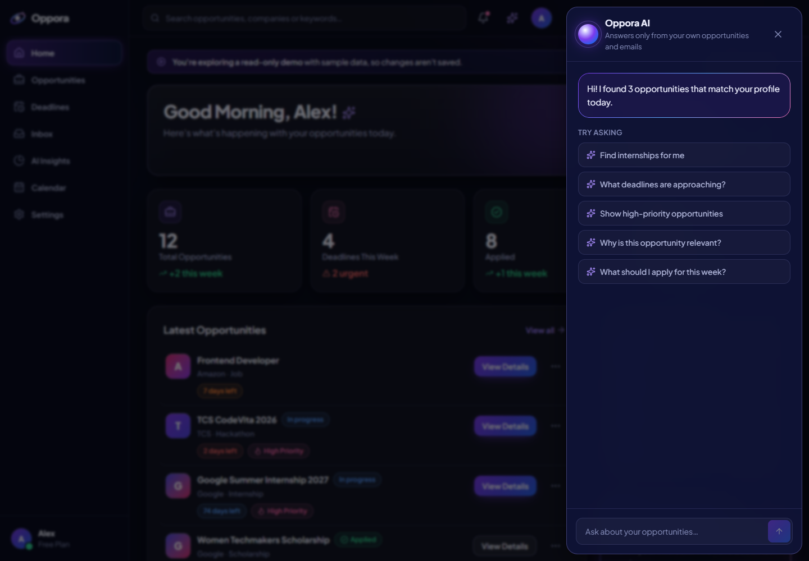
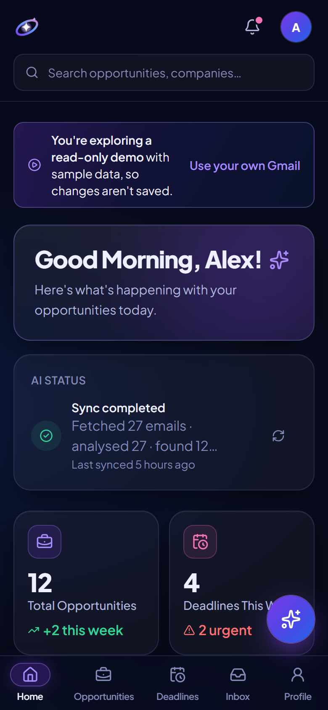
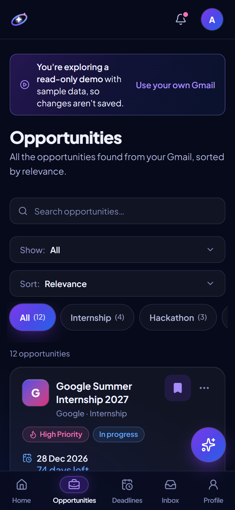
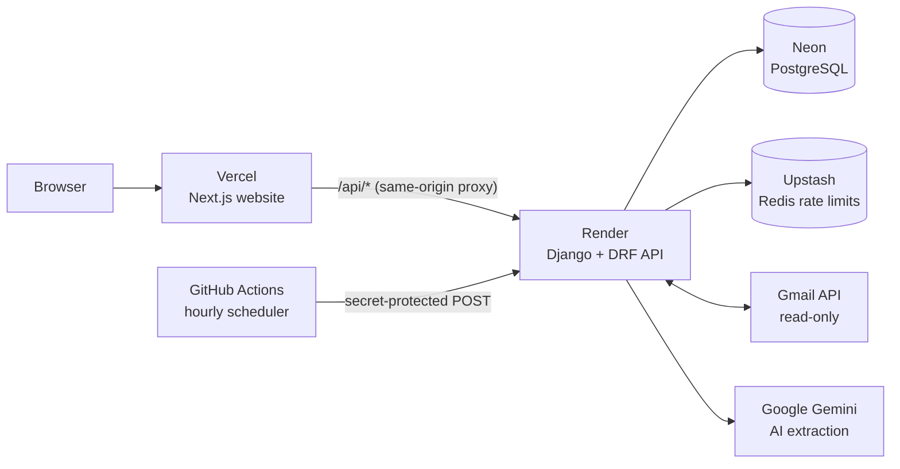

# Oppora

**An AI agent that reads your Gmail (read-only), finds internships, jobs, hackathons, scholarships and events,
tracks their deadlines and ranks them against your profile, so nothing important gets buried in your inbox.**

**Live site: <https://oppora-app.vercel.app>**

> **Try it without Gmail:** on the live site, click **Try the demo**. It opens a shared, read-only sample account
> ("Alex") filled with made-up emails, so no sign-in or Gmail is needed and nothing you do there is saved.
> The first load may take about a minute while the free server wakes up.
>
> Gmail sign-in is invite-only for now (Google's testing phase), so the demo is the way in for visitors.



## Video (60 s)

[](https://youtu.be/7f71WmrXb4o)

**[▶ Watch on YouTube](https://youtu.be/7f71WmrXb4o)**: a one-minute explainer of how Oppora finds opportunities in
Gmail, ranks them and tracks their deadlines.

## Screenshots

| | |
|---|---|
|  **Landing page: Sign in with Google or Try the demo** |  **Opportunities found in the inbox, with match %** |
|  **Details: AI summary and why it matches** |  **Deadlines, coloured by urgency** |
|  **AI insights and application progress** |  **Assistant that answers from your own data** |

On a phone:

<p>
  
  
</p>

All screenshots are from the public demo account, which contains only made-up sample emails.

## Features

- **Finds opportunities in Gmail** (read-only) with an AI model, and never invents details: anything the email
  doesn't say is shown as *Not mentioned in email*.
- **Ranks each one** with a match % you can open and inspect (interests, skills, level, deadline), and warns when
  an email asks for a fee.
- **Tracks deadlines** on a calendar (month, week, day) and reminds you the day before.
- **Keeps your lists**: saved, in progress and applied, with one-tap "Apply now" and "Mark as applied".
- **Assistant** that answers only from your own opportunities and emails, and links what it used.
- **Insights**, a daily briefing and a weekly digest.
- Dark, light or system theme; works on desktop, tablet and phone, by keyboard and with a screen reader.
- **Privacy controls**: an AI consent screen, a rules-only mode that sends nothing to the AI, a personal-detail
  filter, and "Delete my data".

## Tech stack

| Part | Built with | Hosted on (free plans) |
|---|---|---|
| Website | Next.js 16 (App Router), React, TypeScript, Tailwind CSS v4, Radix, Lucide | Vercel |
| API | Python 3.14, Django 5.2, Django REST Framework, gunicorn | Render |
| Database | PostgreSQL 16 | Neon |
| Rate limits | Redis 7 | Upstash |
| AI | Google Gemini (free tier) behind one provider interface | Google AI Studio |
| Email | Gmail API (`gmail.readonly`) with Google sign-in (OAuth + PKCE) | Google Cloud |
| Background work | Celery + Redis locally; on the free plan, short resumable batches and an hourly GitHub Actions scheduler | GitHub |



The browser only ever talks to the website. Next.js forwards `/api/*` to Django, so the session cookie is
first-party and httpOnly, no CORS is needed, and no key ever reaches the browser.

## Interesting engineering

- **Read-only Gmail, done carefully.** Only the `gmail.readonly` scope is requested. Google sign-in uses PKCE, OAuth
  tokens are encrypted at rest (Fernet, with key rotation) and never sent to the browser, and disconnecting revokes
  access at Google.
- **An AI that can't make things up.** One Gemini call per email returns strict structured data; then every link,
  skill, date and fee is checked against the email text itself. Anything that isn't there becomes `null` and shows
  as *Not mentioned in email*.
- **Each email processed exactly once.** The pipeline is idempotent: a Gmail message is never analysed twice, and
  follow-up emails link to the existing opportunity instead of creating a duplicate.
- **Free tier, never failing.** AI calls are rate-limited and capped per day, and the daily budget is shared fairly
  between accounts. Over the limit, emails wait in a queue and resume by themselves after the reset.
- **Works on a server that sleeps.** Render's free plan has no background worker and sleeps after 15 idle minutes, so
  scans run in short batches that save progress after every email, and an hourly GitHub Actions job (protected by a
  shared secret) continues them and sends reminders. The website waits for a sleeping backend instead of failing.
- **A match % you can inspect.** AI relevance is blended with a profile score (interests 40, skills 30, level 15,
  deadline 15). Checks the email can't answer are left out instead of counting against you, and changing your
  profile re-scores without new AI calls.
- **A public demo that can't be changed.** "Try the demo" signs visitors into a shared sample account; a middleware
  refuses every change from it (only reading, the assistant and sign-out are allowed), and the sample data shifts to
  today's date every day.
- **Your data only.** Sessions use an httpOnly, SameSite cookie, every change needs a CSRF token, every query is
  limited to the signed-in user (tested with two users), and every page sends security headers (CSP, no framing,
  HSTS, nosniff).

More detail on each of these: [CLAUDE.md](CLAUDE.md) (decisions and stage notes) and
[backend/README.md](backend/README.md) (API and backend layout).

## Privacy & security

- **Secrets** live only on the server (`.env` locally, the hosting dashboards online). The browser bundle contains no
  keys.
- **Minimum data to the AI:** subject, sender, date and a cleaned, trimmed body with personal details (phone
  numbers, other email addresses, codes) filtered out. Attachments are never read, and email bodies are never
  stored.
- **On Gemini's free tier**, Google may use submitted content to improve its products. Settings → Privacy says
  exactly what is sent, and rules-only mode sends nothing.
- **Rate limits** apply to sign-in, scans, the assistant and the API.
- **Delete my data** (Settings) removes opportunities, emails and notifications and disconnects Gmail.
- **Key rotation:** set `TOKEN_ENCRYPTION_KEY=<new>,<old>`, run
  `backend\.venv\Scripts\python backend\manage.py rotate_token_key`, then remove the old key.

## How it was built

I built Oppora with [Claude Code](https://claude.com/claude-code) as my AI pair-programmer, in 12 stages: I wrote the
product brief and design direction, set the rules (read-only Gmail, never invent facts, free services only, tests
for every stage), made the decisions at each step, and reviewed and tested the results, including with my own real
Gmail before going live.

---

# Running it yourself

Free hosting guide (Vercel, Render, Neon, Upstash, GitHub Actions): [docs/deploy.md](docs/deploy.md).
Google sign-in, Gmail and Gemini setup: [docs/google-cloud-setup.md](docs/google-cloud-setup.md).
A click-by-click 2-minute demo script: [docs/demo-script.md](docs/demo-script.md).

## Quick start (Windows)

### 1. Install once (all free)
1. **Docker Desktop**: <https://www.docker.com/products/docker-desktop/>. Start it and wait until it says *Engine running*.
2. **Node.js 20+** (LTS): <https://nodejs.org/>
3. **Python 3.14** from python.org, with the *py launcher* option ticked.

### 2. Start everything
In PowerShell, from the project folder:

```powershell
powershell -ExecutionPolicy Bypass -File .\start-oppora.ps1
```

The script:
1. checks Docker, Node and Python
2. creates `.env` on the first run and generates any missing secret keys
3. creates the Python virtual environment and installs packages (first run, or when requirements change)
4. runs `npm install` (first run, or when `package-lock.json` changes)
5. starts Postgres and Redis (`docker compose up -d --wait`)
6. applies database migrations
7. opens four windows:
   - **Oppora backend**: Django, port 8000
   - **Oppora worker**: Celery. It runs Gmail syncs and the AI in the background.
   - **Oppora beat**: the scheduler. It does the following:
     - every 10 minutes, it resumes queued emails, including after the AI's daily limit resets;
     - twice an hour, it checks for new mail;
     - at 09:00 your time, it creates deadline reminders;
     - at 08:00, it creates the daily briefing;
     - on Mondays at 08:00, it creates the weekly digest.
   - **Oppora frontend**: Next.js, port 3000
8. opens <http://localhost:3000>

It's safe to run again: anything already running is left alone, except that the backend restarts when `.env` changed, and the worker and beat restart when `.env` or backend code changed. `-ExecutionPolicy Bypass` applies only to this run.

| Option | What it does |
|---|---|
| `-RefreshDemo` | Reloads the demo account's data for today (dates are relative to the load day). Your real account isn't touched. |
| `-Restart` | Restarts Oppora's own servers (never other programs on ports 8000/3000). |
| `-NoBrowser` | Doesn't open the browser. |

**Stop:** close the four *Oppora …* windows. To stop the database too, run `docker compose stop`.

### 3. Sign in
- **Without Google set up:** *Sign in with Google* opens the seeded demo account (local development only).
- **With your real Gmail:** follow [docs/google-cloud-setup.md](docs/google-cloud-setup.md) (about 15 minutes), put the keys in `.env`, and save. The backend restarts by itself, and Google sign-in then replaces the demo sign-in.

---

## Manual setup (macOS, Linux, or without the script)

```bash
cp .env.example .env            # then fill in DJANGO_SECRET_KEY and TOKEN_ENCRYPTION_KEY (see the comments)
docker compose up -d --wait     # Postgres + Redis

cd backend
python3.14 -m venv .venv && . .venv/bin/activate      # Windows: .venv\Scripts\activate
pip install -r requirements.txt -r requirements-dev.txt
python manage.py migrate
python manage.py seed_demo      # demo account; needs Node and `npm install` in ../frontend

# four terminals:
python manage.py runserver 127.0.0.1:8000
python -m celery -A config worker --pool=solo --loglevel=info
python -m celery -A config beat --loglevel=info --schedule .celery/beat-schedule
cd ../frontend && npm install && npm run dev           # http://localhost:3000
```

Without Redis or a worker you can set `JOBS_BACKEND=thread`. Syncs then run inside the web process, but nothing is scheduled.

## Configuration

Every variable is listed and explained in [`.env.example`](.env.example). The ones you'll touch:

| Variable | Purpose |
|---|---|
| `GOOGLE_CLIENT_ID`, `GOOGLE_CLIENT_SECRET`, `GOOGLE_REDIRECT_URI` | Google sign-in and Gmail (read-only). Keep the Google Cloud app in **Testing** mode with your Gmail as a test user. |
| `GEMINI_API_KEY`, `GEMINI_MODEL`, `GEMINI_FALLBACK_MODEL` | The AI. Use a Google AI Studio project **without billing** so it stays free. |
| `AI_REQUESTS_PER_MINUTE`, `AI_REQUESTS_PER_DAY` | Keep at or below your free-tier limits. Over the limit, emails wait in a queue and resume by themselves. |
| `GMAIL_INITIAL_SYNC_DAYS` | How far back the first scan looks (default 60 days). |
| `DEFAULT_USER_TIMEZONE` | Used for "today" until the browser reports your zone. |
| `TOKEN_ENCRYPTION_KEY`, `DJANGO_SECRET_KEY` | Generated by the start script. Never commit them. |

`AI_PROVIDER=openai` switches to OpenAI, which is **paid**. It's never enabled by default.

---

## Checks

```powershell
cd frontend; npm run check                            # ESLint + TypeScript + Vitest
npm run build                                         # production build
cd ..\backend; .venv\Scripts\python -m pytest          # API, pipeline, security, journey, performance
.venv\Scripts\ruff check .; .venv\Scripts\ruff format --check .
.venv\Scripts\python manage.py makemigrations --check --dry-run
```

`backend/tests/test_journey.py` runs the complete journey with Google, Gmail and the AI faked: sign-in → sync → AI analysis → details → save → apply → reminder → assistant.

## Troubleshooting

| Symptom | Fix |
|---|---|
| *Sign in with Google* opens the demo account | Google keys aren't in `.env` yet, or the backend wasn't restarted. Saving `.env` restarts it; `-Restart` forces it. |
| Settings shows **Gmail: Needs reconnect** | In Testing mode Google expires refresh tokens after 7 days. Click **Reconnect**. |
| The sync card says **N emails queued** | The AI's daily free limit is used up. They resume by themselves after the reset (midnight Pacific time) while the worker and beat are running. |
| Port 8000 or 3000 is in use | Another program uses it. The script tells you which. Close it, or change the port. |
| Demo dates look old | Run `start-oppora.ps1 -RefreshDemo`. |

## Status and limits

- **Live since 5 October 2026** on free plans: <https://oppora-app.vercel.app>. Production runs over HTTPS only, with
  `DJANGO_DEBUG=false`, strong secrets (the server refuses to start with weak or missing keys) and its own database
  password on Neon.
- Built in 12 stages; see the stage notes in [CLAUDE.md](CLAUDE.md).
- **Gmail sign-in is invite-only:** the Google Cloud app stays in **Testing** mode (up to 100 listed test users).
  Everyone else can use **Try the demo**. Opening Gmail sign-in to everyone needs Google's restricted-scope
  verification (privacy policy on a verified domain, a demo video and an annual CASA security assessment).
- **Free plan behaviour:** the first visit after 15 quiet minutes takes up to a minute while the server wakes up, and
  scans of a large inbox continue in hourly batches when the AI's free daily limit is reached.
- **Email notifications** need an email provider (not set up; that would be a paid or extra service). Notifications
  appear in the in-app bell.
